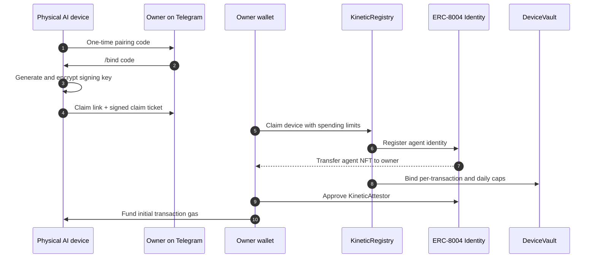
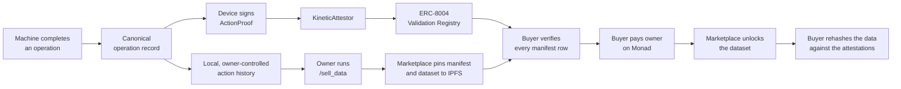

# KineticVM

KineticVM: the physical world is AI's next dataset

**KineticVM gives physical AI an onchain identity and a wallet with spending limits, then records its work with onchain attestations, creating a provenance-backed history its owner can sell and buyers can verify without trusting the seller.**

[Website](https://kineticvm.xyz) ·
[Documentation](https://docs.kineticvm.xyz) ·
[Marketplace](https://marketplace.kineticvm.xyz) ·
[Claim a device](https://claim.kineticvm.xyz) ·
[X](https://x.com/kineticvm)

## Why KineticVM

AI learned from the internet. Its next valuable datasets will come from the
physical world: robots working in factories, machines inspecting products,
and sensors observing farms.

Today, that data is born anonymous. Physical AI devices lack persistent
public identities, their actions become editable logs instead of verifiable
records, and owners have no native way to turn years of machine work into
provenance-backed assets. Buyers cannot independently verify where the data
came from or whether it changed.

KineticVM provides the identity, trust, and economic layer. Each machine gets
an owner-held [ERC-8004](https://eips.ethereum.org/EIPS/eip-8004) identity, a
device-bound signing key, and a contract-enforced wallet. Completed operations
become signed attestations on Monad, while the underlying records remain under
the owner's control until they choose to sell them.

## How it works


### 1. A device becomes an owned onchain agent

The owner configures a device, pairs it over Telegram, and claims it from
their wallet. The device key proves possession by signing an expiring EIP-712
claim ticket; it never owns the identity or receives operator rights over it.




The ERC-8004 NFT stays in the owner's wallet. The device spends from
`DeviceVault`, where the contract enforces a pause switch, recipient
allowlists, a per-transaction cap, and a rolling daily cap. The device cannot
raise its own limits or withdraw the owner's funds.

### 2. Machine work becomes verifiable data

Successful actuator calls can be attested automatically, and builders record completed business operations such as a vend, pick, inspection, or sensor reading through `monad_attest`.




KineticVM stores the exact canonical record signed by the device and anchors
its hash through the ERC-8004 Validation Registry. Over time, those records
form a provenance-backed history tied to one persistent machine identity.

When the owner runs `/sell_data`, the runtime packages the local records and
their request hashes. The marketplace checks ownership, pins a verification
manifest and the data file to IPFS, withholds the data CID, and publishes the
listing. A buyer verifies every manifest row against Monad before paying,
then downloads the dataset and rehashes each record after unlock.

> **What an attestation proves:** the key bound to that ERC-8004 agent signed
> those exact record bytes at that time. It does not, by itself, prove that a
> motor physically moved or that a sensor was calibrated.


## The stack

- **Device runtime:** a single Rust binary with the agent loop, encrypted
device signer, chain client, policy engine, Telegram, MQTT, webhooks, SOPs,
and an HTTP/WebSocket gateway.
- **Hardware:** Raspberry Pi GPIO and JSON-over-serial adapters and firmware
for ESP32, Pico, Nucleo, and Arduino boards.
- **Builder toolkit:** sandboxed WebAssembly plugins, event-driven procedures,
skills, and package tooling for adding machine-specific business logic
without handling device keys or deploying contracts.
- **Web surfaces:** the device claim flow, vault funding and withdrawal, and
the data marketplace with seller keys, onchain verification, payment, and
dataset unlock.

Third-party builders use the shared KineticVM deployment. They install the
runtime, add their plugin and procedure, and define the records their machine
produces; they do not deploy contracts.

## Contracts

KineticVM is deployed on **Monad testnet** (chain ID `10143`). The canonical
addresses live in `[contracts/deployments/10143.json](contracts/deployments/10143.json)`.


| Contract                                               | Address                                                                                                                            | Responsibility                                                                                                        |
| ------------------------------------------------------ | ---------------------------------------------------------------------------------------------------------------------------------- | --------------------------------------------------------------------------------------------------------------------- |
| `[KineticRegistry](contracts/src/KineticRegistry.sol)` | `[0xa361931269F7e0b1957175a48669F14735E61EDA](https://testnet.monadvision.com/address/0xa361931269F7e0b1957175a48669F14735E61EDA)` | Claims or links a device key to an ERC-8004 agent owned by a person; handles rotation, revocation, and NFT transfers. |
| `[DeviceVault](contracts/src/DeviceVault.sol)`         | `[0x77102fCAC7927bB64507DF82bf1ae659465B4EE5](https://testnet.monadvision.com/address/0x77102fCAC7927bB64507DF82bf1ae659465B4EE5)` | Holds MON per agent and enforces the pause state, allowlist, per-transaction cap, and daily cap.                      |
| `[KineticAttestor](contracts/src/KineticAttestor.sol)` | `[0x6e46d149b7d3396b42E874765Cf5a1bb26BD5bA5](https://testnet.monadvision.com/address/0x6e46d149b7d3396b42E874765Cf5a1bb26BD5bA5)` | Verifies device-signed action proofs and writes the result to the ERC-8004 Validation Registry.                       |
| ERC-8004 Identity Registry                             | `[0x8004A818BFB912233c491871b3d84c89A494BD9e](https://testnet.monadvision.com/address/0x8004A818BFB912233c491871b3d84c89A494BD9e)` | Mints the agent NFT and provides the canonical, transferable owner identity.                                          |
| ERC-8004 Validation Registry                           | `[0x8004Cb1BF31DAf7788923b405b754f57acEB4272](https://testnet.monadvision.com/address/0x8004Cb1BF31DAf7788923b405b754f57acEB4272)` | Stores the public validation request, response hash, validator, agent ID, and tag for each attestation.               |
| ERC-8004 Reputation Registry                           | `[0x8004B663056A597Dffe9eCcC1965A193B7388713](https://testnet.monadvision.com/address/0x8004B663056A597Dffe9eCcC1965A193B7388713)` | Shared ERC-8004 reputation surface; the current KineticVM deployment does not write to it.                            |


See [contract documentation](https://docs.kineticvm.xyz/contracts/overview)
and [deployment transactions](https://docs.kineticvm.xyz/contracts/deployments).

## Quickstart

You need a 64-bit Linux machine (including Raspberry Pi) or macOS, an owner
wallet with Monad testnet MON, a Telegram bot token, and a supported model
provider or local Ollama.

```bash
# Install the latest checksum-verified release.
curl -fsSL https://raw.githubusercontent.com/kineticVM-labs/kinetic-vm/main/install.sh | sh

# Configure the device, owner, model, Telegram, and initial spending limits.
kinetic quickstart

# Start the runtime.
kinetic start
```

Then:

1. Send `/bind <code>` to the Telegram bot.
2. Open the claim link and confirm the ERC-8004 identity from the owner wallet.
3. Fund the device vault from the link sent to Telegram.
4. Send `/status` to see the identity, owner, balance, limits, and recent
  attestations.

Follow the complete [ten-minute quickstart](https://docs.kineticvm.xyz/quickstart),
or build the [vending-machine example](https://docs.kineticvm.xyz/tutorials/vending-machine)
to connect an ESP32 and attest real vends.

### Build from source

KineticVM uses Rust 1.96, pinned in `rust-toolchain.toml`.

```bash
cargo build --release
```

The binary is written to `target/release/kinetic`.

## Repository map

```text
contracts/       KineticRegistry, DeviceVault, KineticAttestor, tests, deployments
crates/          Rust runtime, chain client, channels, hardware, plugins, tools
firmware/        Device firmware and the shared serial protocol
vend_plugin/     End-to-end ESP32 vending-machine integration
web/             Website, claim and vault flows, marketplace
docs/            Mintlify documentation
```


## Built on ZeroClaw

KineticVM builds on the rock-solid agent runtime foundation of
[ZeroClaw](https://github.com/zeroclaw-labs/zeroclaw): its provider
abstractions, agent loop, tools, memory, channels, and security model.

On top of that foundation, KineticVM adds the physical-AI protocol and product:
the device signer and owner-claim lifecycle; ERC-8004 and Monad integration;
the registry, vault, and attestor contracts; hardware-action attestations;
canonical operation records; owner commands and constrained payments; builder
packages; claim and vault web flows; and the IPFS data marketplace with
onchain verification and purchase unlock.

The runtime is a modified fork, not the official ZeroClaw project. ZeroClaw's
copyright and attribution remain in `[NOTICE](NOTICE)`,
`[LICENSE-MIT](LICENSE-MIT)`, and `[LICENSE-APACHE](LICENSE-APACHE)`.

## Project status and security

KineticVM currently runs on Monad testnet. The contracts are not upgradeable,
have no global pause, and have **not been externally audited**. Do not use them
with funds you cannot afford to lose. See [SECURITY.md](SECURITY.md) for
private vulnerability reporting.

Device identity, ownership, vault policy, and revocation are canonical
onchain. Local state is used for operation and recovery; when it conflicts
with Monad, the chain wins. Device keys stay behind the signer interface and
must never be logged, exported, or committed.

## Links

- [Website](https://kineticvm.xyz)
- [Documentation](https://docs.kineticvm.xyz)
- [Data marketplace](https://marketplace.kineticvm.xyz)
- [Claim a device](https://claim.kineticvm.xyz)
- [Contract deployments](https://docs.kineticvm.xyz/contracts/deployments)
- [GitHub](https://github.com/kineticVM-labs/kinetic-vm)
- [X / Twitter](https://x.com/kineticvm)


## License

Dual-licensed under [MIT](LICENSE-MIT) or
[Apache 2.0](LICENSE-APACHE), at your option.